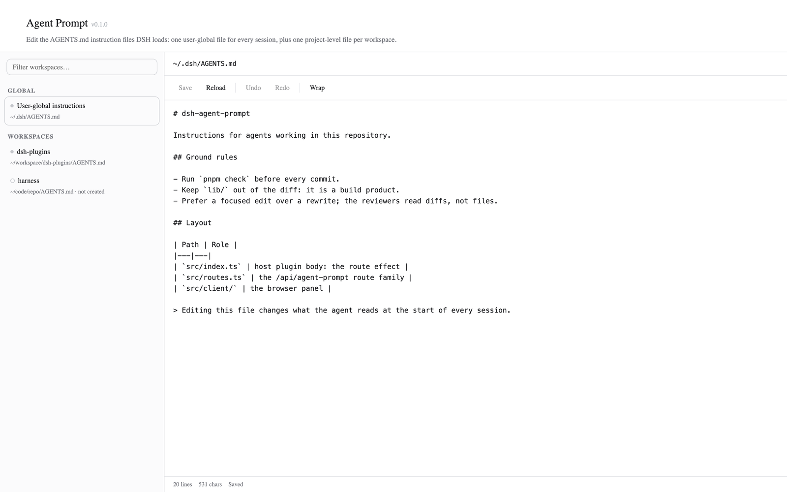

# dsh-agent-prompt

编辑 DeepSeek Harness 实际加载的 `AGENTS.md` 指令文件——用户全局的和每个工作区的
——直接在 GUI 左侧边栏的面板里完成。
[English](README.md) | **中文**

[](LICENSE)
[](https://github.com/icrefin/dsh-agent-prompt/releases/tag/v0.1.0)
[](https://github.com/icrefin/dsh-agent-prompt/actions/workflows/ci.yml)
[](https://github.com/icrefin/dsh-agent-prompt/commits/main)
[](https://github.com/icrefin/dsh-agent-prompt/stargazers)
[](https://github.com/icrefin/dsh-agent-prompt/pulls)
[](https://nodejs.org)
[](https://github.com/deepseek-ai/deepseek-harness)

**Agent Prompt** —— 在 GUI 左侧边栏的面板里，编辑 DeepSeek Harness 实际加载的
`AGENTS.md` 指令文件。

DSH 会在每个会话开始时注入工作区指引，内容取自与 `AGENTS.md` 兼容的文件：
一个用户全局文件，外加一条项目链。平时改这些文件，得开外部编辑器、进终端，
一次只处理一个路径。本插件把它们收进同一个页面：左边是全部全局与各工作区
指令文件的树，右边是纯文本编辑器，再加上一个 Save 按钮——它写下的正是 agent
下个会话将要读到的那些字节。



```
┌── Agent Prompt ────────────────────────────────────────────────────────────┐
│  Filter workspaces…    │  ~/workspace/dsh-plugins/AGENTS.md                │
│                        │    ┌───────────────────────────────────────────┐  │
│  GLOBAL                │    │ Save  Reload │ Undo Redo │ Wrap           │  │
│   ● User-global        │    ├───────────────────────────────────────────┤  │
│     ~/.dsh/AGENTS.md   │    │ # dsh-plugins                             │  │
│  WORKSPACES            │    │                                           │  │
│   ● dsh-plugins        │    │ Instructions for agents working in this   │  │
│   ○ harness  (new)     │    │ repository.                               │  │
│                        │    └───────────────────────────────────────────┘  │
│                        │      20 lines  531 chars                  Saved   │
└────────────────────────────────────────────────────────────────────────────┘
```

## 它贡献了什么

| 界面 | 作用 |
|---|---|
| 侧边栏行 **Agent Prompt** | 图标栏里的一行全局面板，就排在 **Schedules** 正下方 |
| **Agent Prompt** 页面 | 左侧文件树（全局 + 每个已注册工作区一个节点，带过滤器）和右侧编辑器 |
| `GET /api/agent-prompt/tree` | 解析后的文件清单，含每个文件的存在性、大小和 mtime |
| `GET /api/agent-prompt/file?key=…` | 读取一个指令文件 |
| `POST /api/agent-prompt/file` | 写入一个指令文件，文件或其目录缺失时一并创建 |

## 它编辑哪些文件，以及为什么是这些

宿主这一半用与加载这些文件的包
[`@deepseek-ai/dsh-agent-instructions`](https://www.npmjs.com/package/@deepseek-ai/dsh-agent-instructions)
完全相同的规则解析路径。它随包发布的默认值是
`projectRootMarkers: ['.git']`、`instructionFileCandidates: ['AGENTS.md', 'CLAUDE.md']`
和 `dshHome: $DSH_HOME || ~/.dsh`；`@deepseek-ai/dsh-base` 里的 `agent-instructions`
行只设置了 `maxBytes`，所以这套部署里没有任何路径被覆盖。

| 节点 | 解析规则 |
|---|---|
| **用户全局** | `$DSH_HOME/AGENTS.md`，回退到 `~/.dsh/AGENTS.md`。空或全空白的 `$DSH_HOME` 都算作未设置，与加载器保持一致。 |
| **某个工作区** | 从已注册的工作区目录向上走，直到第一个含 `.git` 的祖先目录；文件即 `<that directory>/AGENTS.md`。一路都没有标记时，向上查找终止于工作区目录本身。 |

树中每个节点都显示解析后的绝对路径，文件尚不存在时会标上 `not created`
——保存即创建它。如果某个工作区的项目根与它自身的目录不同（比如 monorepo
里的一个包），显示的是它的仓库根，而不是那个包。

**只提供 `AGENTS.md`。** 加载器在项目链的每一层还接受 `CLAUDE.md`、
`AGENTS.local.md` 和 `CLAUDE.local.md`，并且同样会编辑它们。这些不在本插件的
范围内；这个面板刻意做到每个作用域只对应一个文件。

## 页面

两处注册，key 都是 `agentPrompt`：

| Slot | 注册 | 效果 |
|---|---|---|
| `sidebar.panellist` | `id: 'agentPrompt'`、`order: 11` | 那一行图标 |
| `main` | `key: 'agentPrompt'` | 该行在中间栏打开的页面 |

页面标题带着面板版本和作者署名——`Agent Prompt v0.1.0 Author: icrefin [icrefinai@gmail.com]`——作为 `20px/500` 标题旁的一枚弱化标签，与 `dsh-skill-mgr`、`dsh-mcp-mgr` 一致。

与那两个不同，**这个版本号是构建时内联进浏览器 bundle 的**，而不是从宿主取。
一个插件的前后两半并不同步更新：浏览器 bundle 一旦 revision 变化就立刻被重新
导入，而宿主这一半是启动时的 ESM 导入，会一直提供进程启动时载入的那份代码。
所以只要客户端跑到了正在运行的宿主前面，从宿主取来的标签就会变空——这个面板
当初渲染出一个光秃秃的 `v`，就是这么来的。`tsdown.config.ts` 读取 `package.json`
并定义 `__DSH_AGENT_PROMPT_VERSION__`；`src/client/version.ts` 导出它，值为空时
该标签直接不渲染。

选择这一行调用的是 `ctx.layout.selectPanel('agentPrompt')`，即在运行中的 `main`
注册表里做一次查找，因此两者从构造上就共用同一个 id。`dsh.client.inject` 把
bundle 排在 `dsh-client-ui-sidebar` 和 `dsh-client-ui-layout` 之后，也就是声明
这两个 slot 的那两个包之后。

### 编辑器命令

| 命令 | 快捷键 | 说明 |
|---|---|---|
| Save | `⌘S` / `Ctrl+S` **页面任意位置** | 草稿与磁盘内容一致前禁用 |
| Reload | — | 丢弃草稿并重新读取文件；有未保存修改时先弹确认 |
| Undo / Redo | `⌘Z` / `⇧⌘Z`（原生） | 本地历史记录，因为平台的撤销栈无法由按钮驱动；一串连续输入会折叠成一步 |
| Wrap | — | 软换行开关，记录在 `localStorage` 里 |

剪贴板**一个按钮都没有**：`⌘X`、`⌘C`、`⌘V` 和 `⌘A` 本来就能到达获得焦点的
textarea，而在工具栏上放一份可用平台快捷键的副本纯属噪音。剩下的，恰好就是
textarea 自己够不到的那些。

### 样式契约

面板遵循工作区的 `STYLES.md`：

- **颜色只用 `--dsw-alias-*`**——样式表里没有任何字面 hex，也没有非 alias 的
  token。状态芯片是自身状态色叠在 10% 的 `color-mix(… transparent)` 着色上；
  表面用的是 `bg-layer-1`（树那一列）、`bg-layer-3`（编辑器输入区）和
  `bg-module-platform`（过滤器、芯片）。
- **按钮**用契约里的两族：中性按钮是 8px/12.5px 的裸控件，悬停时依次填充
  `interactive-bg-hover` → `-active`；主操作 Save 用 `button-primary-fill`/`-hover`
  配 `label-primary-foreground`。`brand-primary` 只出现在 `:focus-visible` 描边上
  ——从不作为填充色。
- **字体与几何**：标题 20px/500/28，简介 13px/20，芯片 11px；header 自带
  `padding-top: 28px`，在 Darwin 下还要加上 `--dsh-frame-top-clearance`；页面的
  横向节奏是 `clamp(24px, 4vw, 48px)`。
- **页面根节点上的 `color-scheme: light dark`**，没有任何暗色模式覆盖：token
  本身就同时承载两种模式。

两栏主体是唯一一处刻意的偏离：契约描述的是居中的 960px 单栏页面，而那样会把
「树 + 编辑器」的分栏饿死。header 保留契约的内缩，好让标题与它的兄弟面板对齐，
主体则在它下方满宽铺开。

编辑器就是一个等宽字体的普通 `<textarea>`：没有 Markdown 预览，也没有语法
高亮。带着未保存修改切换文件会先询问，带着未保存修改关闭窗口会触发浏览器
自己的卸载提示。保存或重新读取都会开启一段全新的撤销历史，所以 Undo 永远
不可能退回到宿主从未见过的那份内容。

## 安装

桌面 profile 归 Electron 应用所有，所以安装要走 **Settings → Plugins**（或者
插件管理器工具）；`dsh plugin add` 会拒绝这个 profile。

```sh
pnpm install
pnpm build                              # tsc -> lib/, tsdown -> lib/client.js
npm pack --pack-destination dist        # dist/dsh-agent-prompt-0.1.0.tgz
```

然后在 Plugins 页面添加 `dist/dsh-agent-prompt-0.1.0.tgz`。这个 bundle 会被记录
进 profile 的 `dsh.profile.bundles`，它的 `cordis.patch.yml` 插入行负责挂载宿主
这一半；`dsh.client` manifest 字段则加载浏览器这一半。

两条运维上的注意事项：

- **重装同一个版本等于什么都没做。** pnpm 看到 spec 没变，就放着 `node_modules`
  里已解压的那份不管，所以同一版本下重新构建的 tarball 到不了 profile。先移除
  这个 bundle，再装一次——或者把版本号往上提。
- **首次安装不需要重启；已加载插件的更新，只要涉及宿主侧改动就需要。** 首次
  安装时，宿主路由挂载和浏览器半注册都在安装完成后立刻生效，页面都不用刷新。
  此后两半就开始分道扬镳：浏览器 bundle 会按其新 revision 重新导入，但**宿主
  这一半是启动时的 ESM 导入**，会一直提供进程启动时载入的那份代码。宿主侧
  改动——比如某个路由新增一个字段——只有在下次启动时才会抵达正在运行的应用；
  客户端改动则永远不需要重启。这是上游行为，不是本插件的：`@deepseek-ai/dsh-hmr`
  写得很清楚："replacing installed package versions still requires a restart"。
  如果某个条目报 `failed to import`，就重启。

## HTTP API

两条路由都注册在 `ctx.webServer` 上，并带一道**仅限回环的围栏**：写路由会重写
一个被 agent 当作指令读取的文件，所以暴露在局域网上的 `dsh web` 部署绝不能
提供它。请求另外还有 4 MiB 的上限。

```
GET  /api/agent-prompt/tree
     -> { dshHome, homeDisplay, global: Node, workspaces: Node[], skipped: string[] }

GET  /api/agent-prompt/file?key=global|ws:<workspaceId>
     -> { key, path, displayPath, exists, bytes, mtimeMs, content }

POST /api/agent-prompt/file   { key, content }
     -> the same payload, re-read from disk after the write
```

目标 key 是 `global` 和 `ws:<workspaceId>`。工作区 key 必须指向一个**已注册**的
工作区 id——面板无法被指向任意路径，未知 id 返回 404，而不是去探测文件系统。
`content` 是整个文件正文；文件不存在时读出来是空字符串，写入则会创建缺失的
父目录。

## 配置

无。这个插件没有 Loader 配置、没有设置区块，也没有持久状态：磁盘上的文件
就是状态。

## 架构

| 模块 | 职责 |
|---|---|
| `src/index.ts` | 宿主插件主体：一个 `ctx.effect`，注册整族路由 |
| `src/routes.ts` | `/api/agent-prompt` 路由、回环/方法/请求体三道围栏、目标解析 |
| `src/files.ts` | harness home 解析、`.git` 项目根向上查找、文件 stat/读/写 |
| `src/protocol.ts` | 两半共同 import 的线上契约（路径 + JSON 形状） |
| `src/client/index.tsx` | 浏览器插件主体：locale 字典 + 两处 slot 注册 |
| `src/client/AgentPromptPanel.tsx` | 页面：草稿、dirty 标记、加载/保存、树↔编辑器接线 |
| `src/client/PromptTree.tsx` | 左侧文件树及其过滤器 |
| `src/client/PromptEditor.tsx` | textarea、它的工具栏和撤销历史 |
| `src/client/version.ts` | 标题标签所显示的、构建时内联的版本 |
| `src/client/api.ts`, `styles.ts`, `locales.ts`, `translate.ts` | fetch 包装、注入的 CSS、`en`/`zh` 文案 |

工作区注册表是通过 `ctx.get('workspaceRegistry')` 读的，而不是硬 inject：没有
它，路由照样挂载、全局文件照样可用，只有按工作区的目标会返回 503。

## 开发

```sh
pnpm install
pnpm check     # tsc (host + client) then vitest
pnpm build     # tsc -p tsconfig.build.json && tsdown
pnpm test
```

`lib/` 和 `dist/` 是构建产物，不提交。

### 预览工具

`tools/preview.mjs` 在 GUI 之外渲染构建好的客户端 bundle 并给它截图：它通过
一个桩 `window.__ModuleLoader__` 加载 `lib/client.js`，用一份最小的假客户端
context 调用插件的 `apply`，挂载 `main` 条目，再通过桩掉的 `fetch` 回放一份
抓取下来的树。

```sh
node tools/preview.mjs --out /tmp/ap-preview      # writes index.html + panel.png
node tools/preview.mjs --open                     # ...and opens the PNG
```

它需要宿主机上有 Google Chrome（或 Chromium/Edge），以及 `react` 和 `react-dom`
两个 dev 依赖（预览页加载的正是它们的 UMD 构建）。这就是在运行中的应用里没有
浏览器会话时，检查面板布局与样式表的方式。

## 验证

在本机针对 dsh `0.2.0-rc.2` 运行（桌面 profile `desktop`）。

| 检查项 | 结果 |
|---|---|
| `pnpm typecheck` —— 宿主这一半 | 无错误 |
| `pnpm typecheck` —— 客户端这一半 | 无错误；两处 `slots.register` 调用都对照真实的 `SlotMap` 做类型检查，所以 `main` 与 `sidebar.panellist` 的 id、以及 `agentPrompt` locale 命名空间，都是编译期事实 |
| `vitest run` | **25/25 通过** |
| 实机宿主：`GET /api/agent-prompt/tree` | `200`，harness home 解析为 `~/.dsh`，每个已注册工作区一个节点，携带其真实的 `projectRoot` |
| 实机客户端：Cordis Inspect `Slots` → `sidebar.panellist` | 占用者 `agentPrompt`、`order: 11`、`active: true` |
| 实机客户端：Cordis Inspect `Slots` → `main` | 占用者 `agentPrompt`、`active: true` |
| 预览渲染 | 标题 + 版本标签、文件树、工具栏、编辑器和状态栏都按设计绘制。当 `lib/client.js` 不带 manifest 版本时，这个预览工具还会**让渲染失败**，这是对内联机制的唯一一道检查 |

`test/files.spec.ts`（13 个测试）针对真实的临时文件系统演练路径解析——包括
空字符串情形在内的 `$DSH_HOME` 优先级、包括 worktree `.git` 文件形式在内的
`.git` 向上查找，以及文件缺失、文件位置上出现目录这些情形。`test/routes.spec.ts`
（10 个测试）用真实的回环 HTTP 服务器伺服真实的路由处理函数，并用 `fetch`
驱动它们：树形状、嵌套工作区 → 仓库根、读取不存在的文件、未知目标 key、未知
工作区、全局与工作区文件的创建与往返读写，以及方法围栏。处理函数主体没有任何
一处被桩掉。`test/version.spec.ts`（2 个测试）覆盖版本模块里唯一的那个坑：
在构建期 define 缺席的地方，它必须仍然可 import。

没有自动化测试覆盖的部分：针对实机宿主的端到端写入（路由测试改为写进临时
目录，所以不会碰到真实的 `AGENTS.md`），以及平台剪贴板快捷键——它们属于
浏览器，而不属于本插件。

## 注意事项

- **只支持 `AGENTS.md`**——`CLAUDE.md` 和 `.local` 叠加文件都不提供。
- **不会实时感知外部改动。** 页面只在你选中某个文件或按 Reload 时读取它。
  如果页面打开期间别的东西改了这个文件，保存会直接覆盖它；没有 mtime 检查，
  也没有合并。
- **这些路由对本机任何进程都可达**，与这套组合里其他所有带回环围栏的插件
  API 一样。它们不受 web 应用 `?token=` 启动令牌的保护，因为具名路由会先于
  需要认证的 SPA 回退匹配。
- **在 agent-instructions 配置里钉死 `dshHome` 会与**面板的 `$DSH_HOME || ~/.dsh`
  解析产生分歧。随包发布的组合只钉了 `maxBytes`，所以今天两者是一致的。

## 贡献

欢迎提交 Issue 和 Pull Request——开发环境的搭建方式和 sign-off 要求见
[CONTRIBUTING.md](.github/CONTRIBUTING.md)。安全类问题请按
[SECURITY.md](.github/SECURITY.md) 所述私下报告。

## 许可证

MIT —— 见 [LICENSE](./LICENSE)。

> 如果这个面板让你少跑一趟外部编辑器，一颗 ⭐ star 能帮更多 DSH 用户发现它。